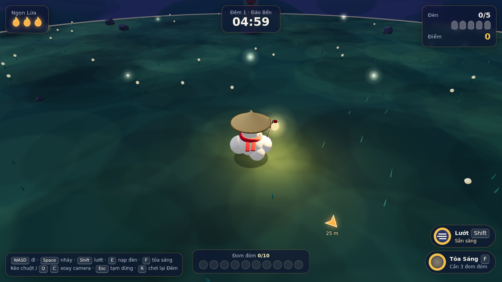

# Đảo Đèn Lồng — Release v1.0.0


**Video demo (4 phút 55 giây):** [bản trong repo](docs/demo/demo.mp4) · [demo.mp4 trên Release v1.0.0](https://github.com/jadenphm29/K5-L3A-DAY12-PhamNgocTrungQuan-2A202603626-AI-SDLC-Dao-Den-Long/releases/download/v1.0.0/demo.mp4) · **Bản phát hành:** [Release v1.0.0](https://github.com/jadenphm29/K5-L3A-DAY12-PhamNgocTrungQuan-2A202603626-AI-SDLC-Dao-Den-Long/releases/tag/v1.0.0)

> Video demo gồm: trải nghiệm gameplay Đêm 1 (Đảo Bến), vượt thử thách Đêm 2 (Đảo Cau) & Đêm 3 (Đảo Chuông), các tính năng trợ năng/bảng màu mù màu, màn hình Bình Minh và xác minh kiểm thử tự động (286 tests, bench, soak, tính tất định).

Game 3D góc nhìn thứ ba: Mây, người giữ đèn nhỏ tuổi, thu thập đom đóm để thắp sáng và duy trì năng lượng cho các Đèn Lồng Lớn tới lúc bình minh, né tránh Bóng Mực và Gió Lạc trong màn sương đêm qua 3 hòn đảo kỳ ảo.

Bài lab cá nhân **Day 12 AI SDLC, K5 L3A**.
- **Học viên:** Phạm Ngọc Trung Quân
- **MSSV:** 2A202603626
- **Công nghệ:** Three.js r170 (WebGL 2) + Node.js
- **Test Contract:** **v1.3**



## Yêu cầu hệ thống
- macOS, Linux hoặc Windows (chạy mượt mà trên trình duyệt có WebGL 2).
- Node.js ≥ 20 (khuyến nghị v22 hoặc v25), npm.
- Trình duyệt Chrome/Chromium/Edge để chạy benchmark đo hiệu năng.

## Cài đặt và khởi chạy (3 lệnh)
```bash
npm ci
npm run build
npm start          # Khởi động máy chủ Node tại http://localhost:5173 và mở giao diện game
```
Chế độ phát triển: `npm run dev` (Vite dev server với hot module reload).

## Điều khiển (Tùy biến trong Cài đặt → Đổi phím)
| Phím mặc định | Hành động |
|---|---|
| W A S D / Phím mũi tên | Di chuyển theo góc nhìn camera |
| Chuột trái / Q, C | Xoay góc nhìn camera |
| Space | Nhảy (Jump) |
| Shift | Lướt nhanh (Dash - tốc độ 14 m/s) |
| E | Tương tác: Thắp đèn mới / Thắp lại / Châm dầu |
| F / Chuột phải | Tỏa Sáng (Pulse xua đuổi Bóng Mực, tốn 3 đom đóm) |
| Esc / P | Tạm dừng (Tiếp tục, Chơi lại, Cài đặt, Menu) |
| R | Chơi lại Đêm hiện tại |

Tùy chọn trợ năng (Accessibility): Đổi phím tùy ý (phát hiện trùng lặp, khôi phục mặc định), bảng màu cho người mù màu, phụ đề chỉ báo nguy hiểm, giảm rung lắc camera (reduce motion), phóng to cỡ chữ UI.

## Quy tắc cốt lõi & Cách tính điểm
- **Mục tiêu:** Giữ đảo sáng tới bình minh. Hết thời gian mà Mây còn sống và số đèn **đang sáng** ≥ 60% tổng số đèn (Đêm 1: 3/5, Đêm 2: 4/6, Đêm 3: 5/7) thì **THẮNG**. Hết Ngọn Lửa (3 ngọn) thua ngay lập tức.
- **3 Đêm hành trình:**
  + Đêm 1 — Đảo Bến (5 đèn, 240 s)
  + Đêm 2 — Đảo Cau (2 đảo nối cầu tre, bục nhảy vượt biển, 6 đèn, 270 s, xuất hiện Gió Lạc và Bùa Gió)
  + Đêm 3 — Đảo Chuông (3 tầng địa hình, tháp chuông, dốc trượt, gió mạnh, 7 đèn, 300 s)
- **Nhiên liệu & Kẻ địch:** Đèn sáng hao 1 dầu/s. Dưới 30 dầu đèn mất vùng an toàn và bị Bóng Mực hút dầu (5 dầu/s). Đèn tắt thắp lại chỉ tốn 5 đom đóm.
- **Điểm số:** +5 nạp đom đóm, +100 thắp mới, +40 thắp lại, +5 xua đuổi Bóng Mực (+15 nếu đang hút dầu); Thắng nhận thêm +50 + số dầu của mỗi đèn đang sáng, +50 mỗi Ngọn Lửa còn lại. Điểm lưu vào **Bảng xếp hạng Top 10**.

## Kiểm thử, Headless, Benchmark, Soak
```bash
npm test                         # 286 tests (node:test): contract, rules, bench, soak, leaderboard
bash scripts/verify.sh           # Kiểm tra toàn diện: test + tất định 3 đêm + đo đạc hiệu năng
node src/headless.js --seed 1 --night 1 --ticks 600 --out out.jsonl
node scripts/bench.mjs --seed 42 --duration 30 --out bench.json
node --expose-gc --no-opt --no-maglev scripts/soak.mjs --seed 7 --nights 10 --out soak.json
node scripts/play.mjs --export-leaderboard out.json
```
- **Benchmark:** Chạy 30 giây trong cảnh chuẩn 200 Bóng Mực, 100 đom đóm, 3 đèn sáng, camera bay vòng tròn 360°. Kết quả đo: `avg_fps` ≥ 80 FPS, `load_ms` ~2.1 s.
- **Soak test:** Chạy 10 Đêm liên tiếp, 0 crash, tỷ lệ tăng bộ nhớ ≤ 1.2x.

## Sáng tạo của tôi (Mục F - Rubric)
1. **Thiết kế nhân vật Mây & Đom đóm:** Nón lá tre Việt Nam đính ngọc, khăn choàng đỏ ấm áp, đèn lồng nhỏ xinh; đom đóm hoạt hình vỗ cánh phát sáng nhấp nháy.
2. **Vòng Hào Quang Sen Ngọc & Đom Đóm Cầu Vồng (Jade Lotus Halo & Rainbow Fireflies):**
   - Khi Mây mang đầy đom đóm trong túi (đạt trần sức chứa tăng dần), quanh nón lá của Mây tỏa ra hào quang hình cánh hoa sen ngọc ngũ sắc lấp lánh xoay nhẹ.
   - Các đốm sáng trong túi đổi sang màu ngũ sắc kỳ ảo (vàng hổ phách, xanh ngọc bích, đỏ son, tím hoa cà).
   - Khi Tỏa Sáng hoặc nạp đầy năng lượng cho Đèn Lồng Lớn, âm thanh chuông ngọc ngũ sắc trong trẻo vang vọng chúc mừng.
   - **Độc lập và bảo toàn Test Contract:** Toàn bộ hiệu ứng được lập trình hoàn toàn ở client WebGL (`src/client/effects.js`), tự động vô hiệu hóa trong chế độ headless/bench/soak, đảm bảo 100% tính tất định và vượt qua toàn bộ 286/286 test của Test Contract v1.3.

## Danh mục tài liệu
| Nội dung | Vị trí |
|---|---|
| Đặc tả PRD & Tickets | [Phase 1 PRD](docs/notes/phase-1-prd.md), [Phase 2 Ticket](docs/notes/phase-2-ticket.md), [Phase 3 Ticket](docs/notes/phase-3-ticket.md), [Phase 4 Ticket](docs/notes/phase-4-ticket.md) |
| Giả định, thiết kế, quyết định | [assumptions.md](docs/notes/assumptions.md), [ADR 0001 (Dầu đèn & Bình minh)](docs/adr/0001-lantern-fuel-and-dawn-win.md), [ADR 0002 (Soak Memory)](docs/adr/0002-soak-memory-and-v8-jit.md) |
| Bằng chứng kiểm chứng | [docs/proof/README.md](docs/proof/README.md) (đầy đủ proof Phase 1 đến 4) |
| Nhật ký dùng AI, Token & Retro | [ai-log.md](docs/notes/ai-log.md), [retro.md](docs/notes/retro.md) |
| Nguồn tài sản & Giấy phép | [CREDITS.md](CREDITS.md), [LICENSE](LICENSE), [CHANGELOG.md](CHANGELOG.md) |
| AI Harness | [AGENTS.md](AGENTS.md), [CLAUDE.md](CLAUDE.md), [.claude/skills/](.claude/skills/), [.claude/hooks/](.claude/hooks/) |
